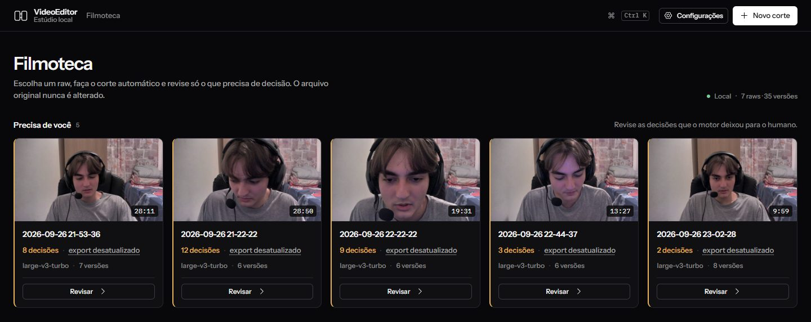
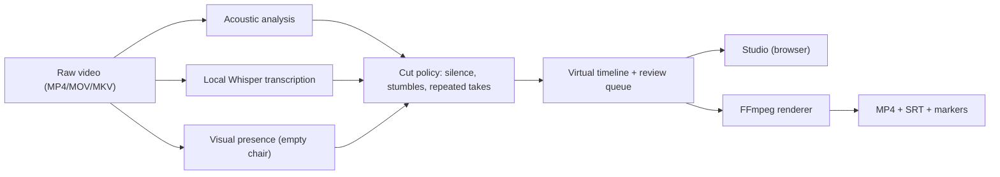

# 🎬 VideoEditor

> **A local rough-cut editor for talking-head videos.** It removes silences, stumbles and
> repeated takes on your own computer, and leaves the doubtful decisions for you to review.

[](https://github.com/otavioxfran/VideoEditor/actions/workflows/ci.yml)
[](https://www.python.org/downloads/)
[](LICENSE)

**Em português:** a interface é em português do Brasil e a transcrição vem configurada para
português. Veja [Como usar (pt-BR)](#-como-usar-pt-br) mais abaixo.



---

## What it does

You record yourself talking. VideoEditor transcribes the recording locally with Whisper,
finds the dead air, the stumbles and the takes you repeated, and builds a virtual cut you
can watch instantly in the browser. It only cuts on its own what is safe (silence, an
empty chair, an exact retake); anything that might remove real content becomes a decision
for you, with the evidence next to it. When you are done, it exports a clean MP4 + SRT
subtitles, ready to finish in CapCut, Premiere or any other editor.

- 🔒 **Runs on your computer.** Video and audio never leave it. Your original file is
  never modified.
- ✂️ **Few decisions, not hundreds.** A 20-minute recording usually leaves around ten
  things to review: repeated takes ("the last one stays"), an empty chair, a false start.
- 🎞️ **Review on a timeline.** Waveform, cuts, pending decisions, zoom, keyboard shortcuts.
- 📤 **Finish elsewhere.** MP4 + SRT + a list of markers for your editor of choice.
- 🤖 **Optional AI notes.** If you turn it on and explicitly allow it, the *text* of the
  transcript (not the audio or video) is sent to Google Gemini's free tier for editorial
  suggestions. It is off by default.

## Status

This is a young project used daily by its author. It works, but setup still needs a
terminal. A one-click Windows installer is on the [roadmap](#-roadmap).

| | Works | Notes |
|---|---|---|
| Windows + NVIDIA GPU | ✅ best experience | NVENC export; 10 min of audio transcribed in ~40 s on an RTX 2060 |
| Windows/Linux without GPU | ✅ slower | Falls back to CPU automatically |
| macOS | ⚠️ untested | CPU only |
| Docker | ✅ for trying it out | CPU only in the provided image |

---

## 🚀 Quick start (local)

**You need:** Python 3.11+, [FFmpeg](https://ffmpeg.org/download.html) in your PATH, and
about 2 GB free for the speech model. An NVIDIA GPU is optional but much faster.

```bash
git clone https://github.com/otavioxfran/VideoEditor.git
cd VideoEditor
pip install -r requirements.txt

# Download the speech model once (~1.5 GB)
python cli.py download-model --model large-v3-turbo

# Open the Studio (it lists ./videos by default; you can pick any file or folder in it)
python cli.py studio
```

The Studio opens at <http://127.0.0.1:8765>. On the first run it checks FFmpeg, your
graphics card and the speech model, and offers to download the model with a progress bar
(without an NVIDIA card it picks a lighter model). Click **Novo corte → Escolher vídeo no
computador…**, pick any recording, then review the decisions and export.

On Windows you can also double-click `start-studio.cmd`. The folder listed in the Studio
can be changed in **Configurações → Pasta de vídeos**. When installed in a read-only
program folder, cuts and settings go to `%LOCALAPPDATA%\VideoEditor`;
`VIDEOEDITOR_DATA_DIR` overrides it.

### Docker

```bash
mkdir -p videos jobs        # put your recordings in ./videos
docker compose up -d        # then open http://localhost:8765
```

The image runs on the CPU, so transcription is slow on long videos. It is a good way to try
the tool; for daily use, run it locally.

### Command line

```bash
python cli.py process "./videos/my_recording.mp4" --automatic --render-now
python cli.py report JOB_ID      # naturalness metrics of the current cut
```

---

## 🇧🇷 Como usar (pt-BR)

1. Instale o [Python 3.11+](https://www.python.org/downloads/) (marque "Add Python to PATH")
   e o [FFmpeg](https://www.gyan.dev/ffmpeg/builds/).
2. Baixe este projeto (botão verde **Code → Download ZIP**) e extraia.
3. Na pasta do projeto, abra o terminal e rode `pip install -r requirements.txt` (uma vez só).
4. Dê dois cliques em `start-studio.cmd`. O navegador abre o Studio.
5. Na primeira vez, o Studio confere o computador e oferece **Baixar** o modelo de
   transcrição, com barra de progresso.
6. Clique em **Novo corte → Escolher vídeo no computador…**, revise as poucas decisões que
   aparecerem e clique em **Exportar MP4 + SRT**.

Quer que a lista mostre outra pasta? **Configurações → Pasta de vídeos → Trocar pasta…**.
As opções avançadas (modelo, edição experimental, briefing) ficam escondidas até você ligar
**Configurações → Interface → Mostrar opções avançadas**.

Quer que a assistência editorial conheça o seu estilo? Copie `PERSONA.example.md` para
`PERSONA.md` e escreva sobre o seu canal. Esse arquivo fica só no seu computador.

---

## 🛠️ How it works



The interface follows [`ui/DESIGN.md`](ui/DESIGN.md).

## 🧪 Tests

```bash
pip install -r requirements-dev.txt
python -m pytest -q
```

## 🗺️ Roadmap

- One-click Windows installer (bundled Python and FFmpeg).
- Transcription language selector and an English interface.

## 🤝 Contributing

Issues and pull requests are welcome. Read [CONTRIBUTING.md](CONTRIBUTING.md) and the
[code of conduct](CODE_OF_CONDUCT.md). Security issues: see [SECURITY.md](SECURITY.md).

## 📄 License

[MIT](LICENSE). Third-party components and their licenses are listed in
[THIRD_PARTY_NOTICES.md](THIRD_PARTY_NOTICES.md).
